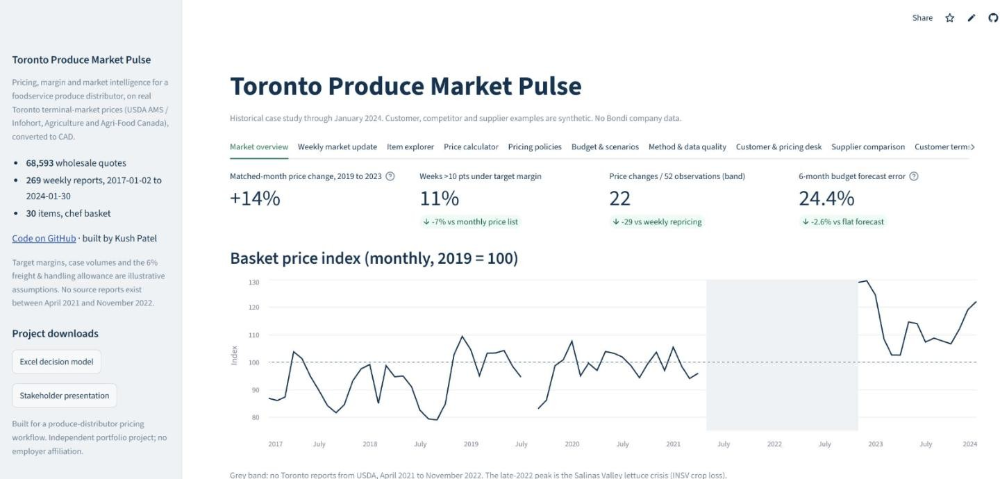
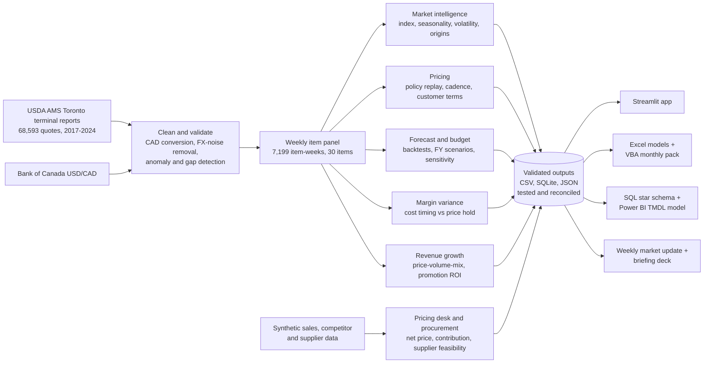
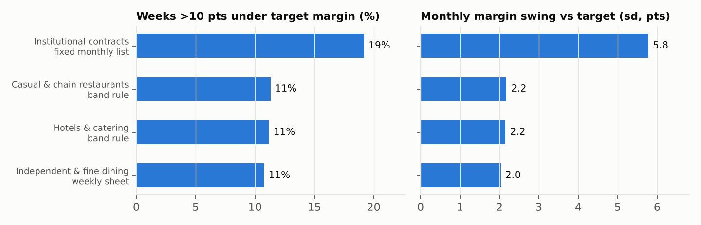
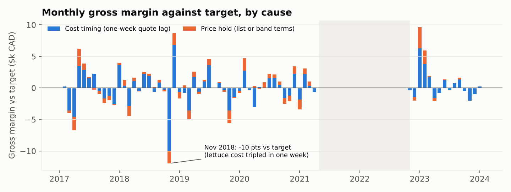
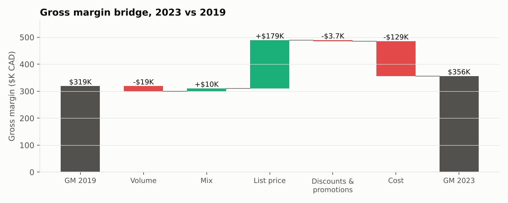
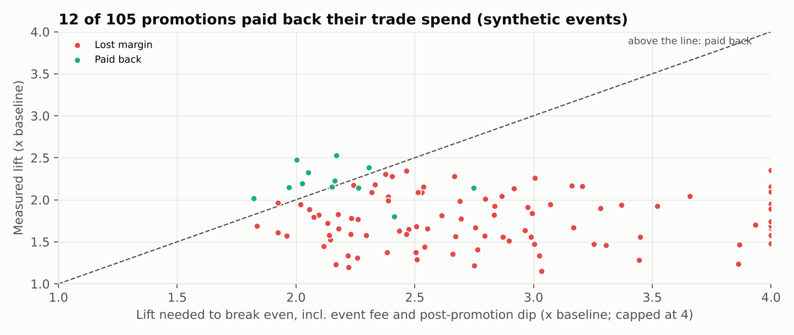

# Toronto Produce Market Pulse

**Pricing, margin and market intelligence for a foodservice produce distributor, built on 68,593 real Toronto wholesale prices.**

[](https://github.com/KushPatel29/toronto-produce-market-pulse/actions/workflows/quality.yml)
[](https://toronto-fresh-market-pulse.streamlit.app)


[](https://toronto-fresh-market-pulse.streamlit.app)

A distributor's pricing analyst has to answer the same questions every week: *what is the market doing, which prices need to move, where is margin leaking, and what does it mean for the budget?* This project answers them end to end on public Toronto terminal-market data (USDA AMS, credited to Infohort / Agriculture and Agri-Food Canada), 2017–2024, converted to CAD.

> **Historical portfolio case study.** Public quotes run from 2017-01-02 to 2024-01-30. Customers, competitors, suppliers, demand, freight and spoilage are synthetic or illustrative assumptions and are labelled as such. No Bondi company data, live ERP integration or realised savings are claimed.

## Start here

| If you have | Open | You will see |
|---|---|---|
| 2 minutes | [Live app](https://toronto-fresh-market-pulse.streamlit.app) | Eleven tabs: market overview, weekly update for any of 265 weeks, item explorer, price calculator, pricing policies, budget levers, customer pricing desk, supplier comparison, customer terms and margin variance, price-volume-mix and promotions |
| 5 minutes | [Stakeholder briefing (7 slides)](outputs/Produce_Pricing_Decision_Brief.pptx) | Pricing cadence, supply-shock lag, customer terms, margin variance, Finance bridge, supplier decisions |
| 10 minutes | [Excel decision model](outputs/Pricing_Decision_Workbook.xlsx) · [Margin variance workbook](outputs/Margin_Variance_and_Terms.xlsx) · [VBA pack](excel_vba/) | Live scenario formulas, native PivotTable, monthly variance bridge with zero-check columns, price-volume-mix waterfall, promotion break-even calculator, ERP price-list upload, VBA macros that validate and export the monthly pack |
| 15 minutes | [Power BI model as code](powerbi/) | TMDL semantic model: 8 tables, 38 DAX measures, row-level security, French translations |
| An interview | [Job-description map and walkthrough](docs/ROLE_COVERAGE.md) | Every responsibility mapped to evidence, with its limits |

## Results at a glance

| Question | Answer | Evidence |
|---|---|---|
| How much has the basket moved? | **+14.2%** from 2019 to 2023 on matched months; 15 of 18 items rose | `outputs/price_change_2019_vs_2023.csv` |
| How fast can supply break? | Romaine reached **4.5x** its 2019 average (CAD 139 vs 31 a case) in the late-2022 lettuce crisis | Weekly update for 2022-12-13 |
| How often should prices change? | A 5-point margin band cuts weeks >10 points under target from **18.5% to 11.2%** with 22 price changes a year, vs 50 for weekly repricing | `outputs/pricing_policy_backtest.csv` |
| Which customers carry the risk? | Fixed monthly contract prices: **19%** of weeks >10 points under target vs about 11% for other terms; an escalator clause cuts it to **12%** | `outputs/terms_profitability.csv` |
| Why did margin miss target? | Mostly timing: quoting on last week's cost is **72%** of the monthly swing; price holds are the rest | `outputs/margin_variance_by_month.csv` |
| Can the budget forecast beat flat? | 6-month error **24.4% vs 27.0%** on unseen 2023, with seasonal strength chosen on 2019–2020 only | `outputs/budget_horizon_forecast_test_2023.csv` |
| What drove gross margin, 2019 to 2023? | List price **+$178,920** and cost **−$129,247**; volume −$18,853, mix +$10,190, discounts −$3,705 on synthetic volumes | `outputs/rgm/pvm_bridge_2019_2023.csv` |
| Do promotions pay back? | Only **12 of 105**: a 10% cut needs **2.23x** baseline volume to break even once the fee and post-promotion dip count; lift estimates land within 7.7 points of the planted truth | `outputs/rgm/promotion_events.csv` |
| Do the numbers tie out? | Contribution bridge agrees between SQL and Python within CAD 0.001; the margin-variance bridge ties to the dollar in Python, SQL and Excel | `validate_release.py`, `tests/` |

## How it works



## What the evidence supports

### Market: the basket moved, unevenly

Across 18 items with at least 10 calendar months observed in both 2019 and 2023, case prices changed +14.2% on a geometric-mean basis; 15 items rose. Months have equal weight. This selected-basket case-price comparison is not a full-year produce inflation estimate; origin and size mix may differ.


### Supply shocks: the late-2022 lettuce crisis

Crop losses in California's Salinas Valley pushed romaine to CAD 139 a case against a 2019 average of 31. The weekly Market Update for 2022-12-13 flags it with top movers, supply shifts and a reprice list ([report](outputs/market_update_2022-12-13.md)).


### Pricing: a risk and friction trade-off

Each policy prices from the most recent prior cost and restarts after item-specific gaps over 14 days. Results are equal-item means on retrospectively cleaned costs and fixed illustrative demand.

| Policy | Scored observations >10 margin points below target | Price changes per 52 scored observations |
|---|---:|---:|
| Monthly list | 18.5% | 11.9 |
| Margin band | 11.2% | 21.9 |
| Weekly repricing | 11.1% | 50.5 |

The calmest policy that keeps breaches under 10% of weeks is: monthly list for 4 items, band rule for 6, weekly repricing for 20. Cadence choices are retrospective selections on the same history, not validated future recommendations.


### Customer terms change risk, not margin

Four customer types buy the basket on different terms, replayed on real weekly costs with the same gap rules. Each lands within 0.2 points of its target margin over the cycle, but a fixed monthly contract list spends 19.2% of scored weeks more than 10 points under target, against 10.8%–11.3% for the others, and its monthly margin swings 5.8 points against about 2. A band-rule escalator clause cuts contract breach weeks to 11.7%. Customer shares and terms are assumptions in `config/customer_terms.csv`, separate from the synthetic pricing-desk customers.



### Margin variance by cause

Gross margin minus margin at target splits exactly into *cost timing* (quotes go out on last week's cost) and *price hold* (the extra cost of keeping a list or band price). Month by month, cost timing is 72% of the absolute swing and the larger cause in 88% of months. The worst month, 2018-11, was 10.2 points under target when lettuce costs tripled in one week; CAD 9,937 of the CAD 11,967 shortfall was cost timing.



### Price, volume, mix and promotions

Gross margin is bridged from 2019 to 2023 item by item: volume (total cases at the old mix and margin), mix (shifts between items), list price, discounts and promotions, and cost. On real terminal costs and synthetic shipments, list price added $178,920 and cost took $129,247; volume took $18,853, mix added $10,190 and deeper discounts took $3,705. The bridge closes to the cent in Python and in Excel (a native waterfall chart with a zero check), and the Power BI measures implement the same algebra.



Each of 105 synthetic promotions is scored against a baseline of clean weeks either side, net of the post-promotion dip and a fixed event fee. Break-even lift rises steeply with depth: 2.23x baseline volume at 10% off, 2.44x at 12%, 3.03x at 15%. 12 events paid back; the verdicts are 12 repeat, 59 redesign, 34 stop. Because the lift is planted in the simulation, the method can be checked: estimates land within 7.7 points of the truth on average. That validates the method, not any real promotion.



### Forecasts and the FY budget

In the calendar-2023 budget holdout, half-strength seasonality has 3-month WAPE 27.4% versus flat 29.1%; 6-month WAPE is 24.4% versus flat 27.0%. Strength 0.5 is the narrow joint minimum over 3- and 6-month validation horizons with origins in 2019–2020. Seasonal estimates use complete 12-month item-years with equal month weights. One to four weeks ahead, the latest price is the best forecast (7.2% WAPE one week out), so the operational answer is to react fast. The FY budget runs on the seasonal path with FX, supply-shock, freight and volume scenarios; shock onset and reversal are both lagged.


### Commercial reconciliation

The latest synthetic week has CAD 31,947 revenue and CAD 8,076 contribution. Independent SQL and Python contribution totals agree within CAD 0.001. Contribution includes variable delivery and spoilage and excludes fixed overhead; the historical policy gross margin uses a different cost basis.

## Skills for the role

| Skill | Reviewable evidence |
|---|---|
| Pricing models | Prior-cost policy replay, cadence by item, price calculator, customer-terms replay, ERP-style price-list upload |
| Market analysis and updates | Public quotes in CAD, matched-month comparison, seasonality, origin shifts, weekly Market Update for any report week |
| Margin and profitability | Policy and customer-terms margins; revenue-weighted customer and product contribution; monthly margin-variance bridge |
| Revenue growth management | Price-volume-mix bridge, discount rate, promotion baseline and lift, break-even lift, trade-spend ROI with repeat/redesign/stop verdicts |
| Forecasting and budgeting | Calendar-origin backtests; FY budget with scenarios and one-at-a-time sensitivity |
| Scenario planning | Live FX, supply-shock, freight, volume and price-lag levers in the app and the Excel model |
| Advanced Excel and VBA | Decision model with live scenario formulas and a native PivotTable ([verification](docs/EXCEL_MODEL.md)); margin-variance workbook with zero-check columns, PVM waterfall and break-even grid; [VBA macros](excel_vba/) that validate, summarise, export to PDF and log the monthly pack |
| SQL and data management | SQLite financial views; star schema (`sql/star_schema/`) with three analysis queries; validated data contract |
| BI and dashboards | Eleven-tab Streamlit/Altair app; [Power BI semantic model as code](powerbi/) (TMDL/PBIP): star schema, 38 DAX measures, dynamic row-level security, fr-CA translations; the report page itself is left blank |
| Procurement | Yield- and freight-adjusted order costs with capacity, MOQ, lead-time and validity checks |
| Communication | Generated stakeholder brief and an editable seven-slide PowerPoint briefing |
| Process improvement | One-command rebuild, deterministic exports, source checksums, regression tests and CI on every push |

[Full job-description map and interview walkthrough](docs/ROLE_COVERAGE.md). Work samples cannot establish a degree, industry tenure or real employer collaboration.

## Why the numbers can be trusted

- **Source integrity:** SHA-256 checksums of the public snapshot are verified on every release (`config/source_manifest.json`).
- **Data-quality defects caught, not hidden:** four weeks where USDA's currency conversion failed (prices left in CAD or converted twice) are detected and excluded; exchange-rate noise is removed so an unchanged CAD price reads exactly 0.0%.
- **No bridged gaps:** the April 2021 – November 2022 source gap and item-specific gaps are never treated as one week, in models or charts.
- **Reconciliation:** financial identities are tested in Python and re-computed independently in SQL and Excel.
- **Automated checks:** `pytest` covers financial identities, hand-calculated lag paths, missing calendar periods, future-data invariance, invalid and duplicate records, and the real Streamlit controls; GitHub Actions runs lint, tests and release validation on every push.

## Reproduce it

```bash
python -m pip install -r requirements-lock.txt
python run_pipeline.py            # clean data, analyses, charts, customer terms, star schema, PVM and promotions
python build_commercial_demo.py   # synthetic pricing desk and supplier comparison
python build_terms_workbook.py    # margin-variance workbook (terms, variance, PVM, promotions)
python build_powerbi_model.py     # Power BI TMDL model
python add_terms_slides.py        # customer-terms slides in the briefing
python build_project_docs.py      # this README, numbers synced from outputs
python build_report_page.py
python validate_release.py
python -m pytest -q && ruff check .
streamlit run app.py
```

Tested on Python 3.12. CSV, Markdown, SQLite and HTML files regenerate from committed sources. The decision workbook and the five base briefing slides are editable delivery snapshots; the margin-variance workbook and the two customer-terms slides are rebuilt by script. The original 13-sheet workbook is kept as a historical artifact.

```
src/pulse/panel.py        cleaning, FX and retrospective anomaly detection
src/pulse/market.py       matched months, complete-year seasonality, calendar risk
src/pulse/pricing.py      prior-cost policy replay with item-gap resets
src/pulse/forecast.py     calendar origins and prior-year training
src/pulse/budget.py       scenarios and lagged shock reversal
src/pulse/report.py       weekly Market Update generator
src/pulse/commercial.py   net-price comparability and customer contribution
src/pulse/procurement.py  synthetic supplier feasibility and order cost
src/pulse/terms.py        customer pricing terms, margin-variance bridge, ERP price list
src/pulse/rgm.py          price-volume-mix bridge and promotion evaluation
src/pulse/datamodel.py    star schema -> SQLite and Power BI CSVs
sql/                      financial views and star-schema queries
powerbi/                  TMDL semantic model (PBIP), DAX measures
excel_vba/                VBA modules for the monthly pack and ERP export
app.py                    Streamlit app (11 tabs)
tests/                    pytest suite, run in CI
```

## Sources and limits

- Public snapshot: USDA AMS MyMarketNews Toronto reports TO_FV010/020/030, credited to Infohort/AAFC; Bank of Canada report-date USD/CAD. Raw snapshot has 69,104 rows; 68,593 valid unique quotes remain after cleaning. The 30-item basket is a subset. [USDA portal](https://mymarketnews.ams.usda.gov/) · [Bank of Canada Valet](https://www.bankofcanada.ca/valet/docs).
- Four anomaly exclusions use a centred window and inferred conversion diagnoses. Backtests are conditional on retrospective cleaning, not fully as-of live simulations.
- There is a major April 2021–November 2022 gap plus item-specific gaps. No live daily or current-news feed is claimed.
- Terminal quotes are cost proxies, not invoices or distributor selling prices. Quote counts are not volumes or confirmed availability.
- Shipment volumes and promotion events in the price-volume-mix and promotion analysis are synthetic, built on real costs, so the method can be checked against a planted truth; they are not a distributor's results.
- Commercial and supplier data are fictional. No causal elasticity, demand response, split-supplier optimisation or realised savings are inferred.
- Budget scenarios lag shock multipliers while retaining the baseline seasonal price path. Inventory financing, fixed overhead and customer contracts are excluded.

[Review and operation](docs/REVIEW_AND_OPERATIONS.md)

---

Built by **Kush Patel**, data analyst in the Greater Toronto Area · [LinkedIn](https://www.linkedin.com/in/kush-patel-48885719b) · [Portfolio](https://kushpatel29.github.io) · [GitHub](https://github.com/KushPatel29)
