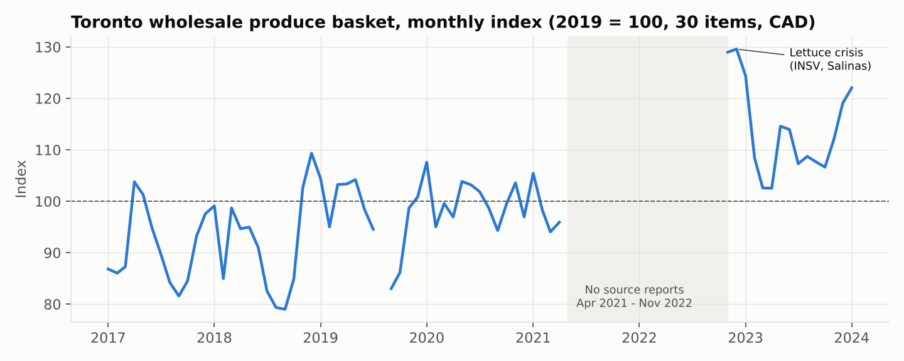
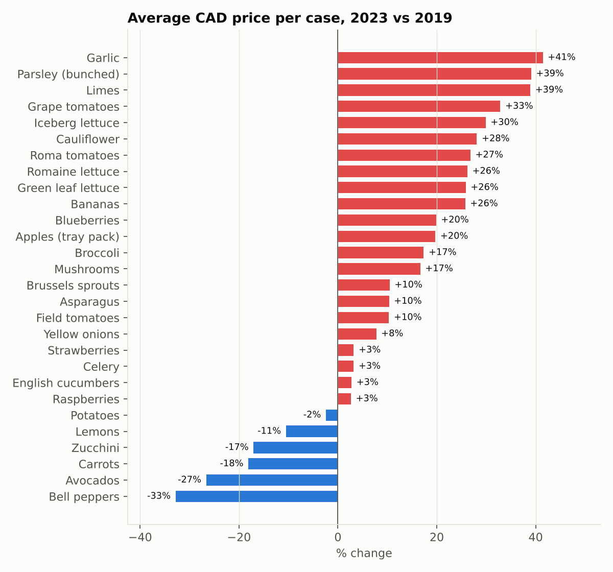
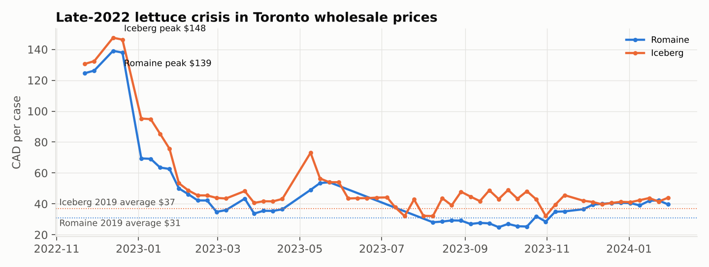
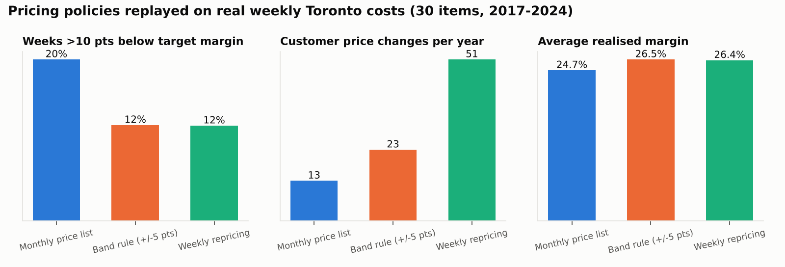
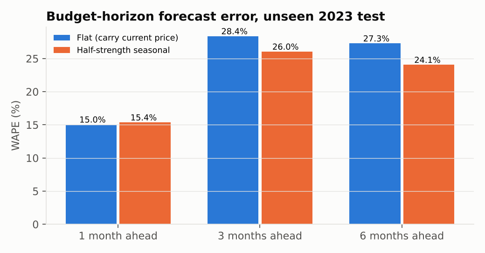
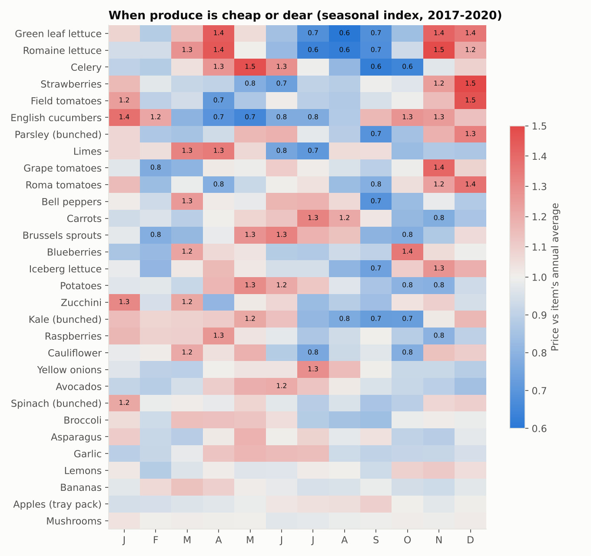
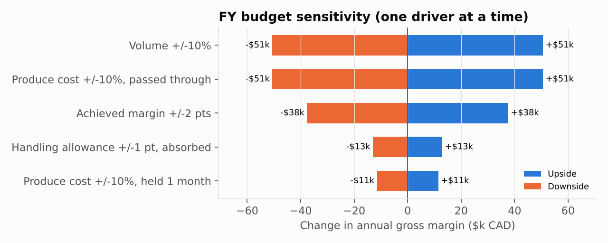

# Toronto Produce Market Pulse

**Pricing, margin and market intelligence for a foodservice produce distributor, built on real Toronto wholesale prices.**

**[Open the live app](https://toronto-produce-market-pulse.streamlit.app)**: pick any week from 2017 to 2024 and get that week's Market Update, replay pricing policies item by item, price an item with the calculator, and move budget scenario levers. A static one-page report is in [`outputs/index.html`](outputs/index.html).

I built this to show the work a pricing and data analyst does at a GTA produce distributor: track the market every week, set and defend prices, protect margin when supply breaks, and turn all of it into a budget Finance can use.

| | |
|---|---|
| **Data** | 68,593 real wholesale price quotes from the Toronto terminal market, 269 weekly reports, Jan 2017 to Jan 2024 |
| **Basket** | 30 items a chef-focused distributor carries (tomatoes, lettuces, brassicas, staples, berries, citrus, herbs) |
| **Deliverables** | Interactive Streamlit app, weekly Market Update generator, pricing-policy backtest, seasonal buying calendar, FY budget with scenarios, Excel pricing model with a native PivotTable |
| **Stack** | Python (pandas, NumPy), Streamlit + Altair, Excel (structured tables, native PivotTable, INDEX/MATCH, AVERAGEIFS, scenario formulas), matplotlib, pytest |



## What I found

**1. Produce in this basket costs about 10% more than in 2019, but the average hides big differences.** Across 28 items with full-year data in both years, the average CAD price per case rose about 10% from 2019 to 2023 (geometric mean). 22 of the 28 rose. Garlic, parsley and limes were up roughly 40%. Bell peppers (-33%), avocados (-27%) and carrots (-18%) fell. A single "produce inflation" number would misprice a third of the basket.



**2. The late-2022 lettuce crisis shows up clearly in Toronto.** Romaine peaked at $139 a case and iceberg at $148 in December 2022, against 2019 averages of $31 and $37. It took until about March 2023 to normalise. The cause was crop loss from Impatiens Necrotic Spot Virus (INSV) in California's Salinas Valley ([Western Farm Press](https://www.farmprogress.com/commentary/salads-will-be-in-short-supply-for-thanksgiving), [Blue Book](https://bluebookservices.com/?p=430031)). The generated Market Update for 2022-12-13 is in `outputs/`. It shows what the report would have told Sales that week.



**3. A monthly price list earns the same margin dollars but carries much more risk.** I replayed three pricing policies against every real weekly cost. Each policy prices from last week's cost, because quotes go out before the market week is known.

| Policy | Weeks >10 pts below target margin | Margin volatility (sd) | Customer price changes / year |
|---|---|---|---|
| Monthly price list | 20% | 19.5 pts | 13 |
| **Band rule** (reprice when margin drifts ±5 pts) | **12%** | **12.6 pts** | **23** |
| Weekly repricing | 12% | 12.5 pts | 51 |

Over a full cycle, gross-margin dollars are almost identical (within 1% across policies, at the illustrative volumes), because weeks above target offset the spikes. The case for the band rule is risk: it cuts breach weeks by about 40%, with less than half the price changes of weekly repricing. The model recommends a monthly list only for 3 genuinely stable items: apples, bananas and mushrooms. It recommends the band rule for 6 (avocados, carrots, garlic, kale, lemons, onions). The other 21, mainly lettuces, berries, tomatoes and greenhouse veg, need weekly repricing.



**4. Next week's best forecast is this week's price.** Over 1 to 4 weeks, carrying the latest price forward ("naive") beat a moving average, exponential smoothing and seasonal models. Its weighted error was 7.6% one week ahead. So the operational answer is to react fast, not to predict.

**5. Seasonality does pay off at budget horizons, if you shrink it.** I chose the seasonal strength on 2019–2020 data only (half-strength won). I then tested it on 2023, which the choice never saw. Error fell from 28.4% to 26.0% three months ahead and from 27.3% to 24.1% six months ahead. One month ahead there was no gain. The budget uses this method.



**6. A seasonal buying calendar.** Lettuces run about 40–50% above their annual average in April and November and 30–40% below it in July–September. Cucumbers peak in winter. Strawberries and field tomatoes are dearest in December. This drives the "next 4 weeks" outlook in every Market Update and the timing of contract buys.



**7. FY budget with scenarios.** The base budget for Feb 2024–Jan 2025 is $1.88M revenue and $506K gross margin (26.9%) at illustrative volumes. I sized the supply shock from the data: a 1-in-10 month runs 38–41% above the trailing-year average for lettuce and tomatoes. That shock costs $8K, mainly because March prices lag. Handling costs up 10% cost $8K, and volume down 5% costs $25K. A weaker CAD adds gross-margin dollars only because cost-plus pricing passes it through, after one month of lag.



## Data quality

I found two problems in the published data. The pipeline handles both, and the tests check both.

- **Currency-conversion failures.** In 4 weeks every item jumped by the same factor and then reverted. In 2 of them the factor equals that week's USD/CAD rate: prices were published in CAD but labelled USD. In the other 2 it is roughly USD/CAD squared, meaning the prices were converted twice. `detect_conversion_anomalies` finds these weeks automatically and excludes them (see `data/processed/dq_excluded_weeks.csv`).
- **Exchange-rate noise in week-over-week changes.** USDA republishes Infohort's CAD prices in USD at its own weekly rate. About 45% of quotes each week are really unchanged in CAD but still move in USD. The pipeline estimates USDA's conversion factor from those unchanged quotes. It then measures every change against that factor, so an unchanged price reads exactly 0.0% and not ±1–2%.
- **Source gap.** USDA published no Toronto reports between April 2021 and November 2022. Nothing bridges it: indexes, backtests and pricing replays all run within each period.

## Repository

```
config/basket.csv            30-item basket, target margins and weekly volumes (illustrative assumptions)
data/raw/                    USDA quotes (all 69,104 rows as pulled) and Bank of Canada USD/CAD on each report date
src/pulse/panel.py           cleaning, CAD conversion, conversion-anomaly detection, like-for-like weekly changes
src/pulse/market.py          basket index, 2019 vs 2023 change, seasonality, volatility, origin mix
src/pulse/pricing.py         pricing-policy replay, cadence recommendation
src/pulse/forecast.py        weekly and budget-horizon backtests (no look-ahead)
src/pulse/budget.py          FY budget, scenarios, sensitivity
src/pulse/report.py          weekly Market Update generator
src/pulse/charts.py          static charts for this README and outputs/index.html
app.py                       Streamlit app (7 tabs) on the processed data
run_pipeline.py              runs everything -> outputs/
build_workbook.py            Excel model (4,500+ live formulas) -> outputs/Toronto_Produce_Pricing_Model.xlsx
add_native_pivot.py          adds a native Excel PivotTable via LibreOffice
tests/                       12 data-quality and logic tests (pytest)
```

```bash
pip install -r requirements.txt
python run_pipeline.py && python build_workbook.py && pytest -q
streamlit run app.py
```

## Sources and assumptions

- Prices: USDA AMS Market News, *Toronto, Canada Terminal Market* fruit (TO_FV010), vegetable (TO_FV020) and onion/potato (TO_FV030) reports. USDA credits the source as Infohort, Agriculture and Agri-Food Canada. The series is now discontinued; the last report is 2024-01-30. Pulled from the MyMarketNews public data service on 2026-11-13.
- FX: Bank of Canada daily USD/CAD (FXUSDCAD). Each report date uses that day's rate, or the most recent prior one; 2017-01-02 uses the 2017-01-03 rate.
- **Assumptions, not company data:** target margins by category (20–32%), weekly case volumes, and a 6% freight and handling allowance on top of the terminal price. The terminal price stands in for a distributor's replacement cost. Every assumption is a blue input cell in the Excel model.
- Prices are case prices on the Toronto terminal (wholesale) market, not distributor-to-restaurant prices.
